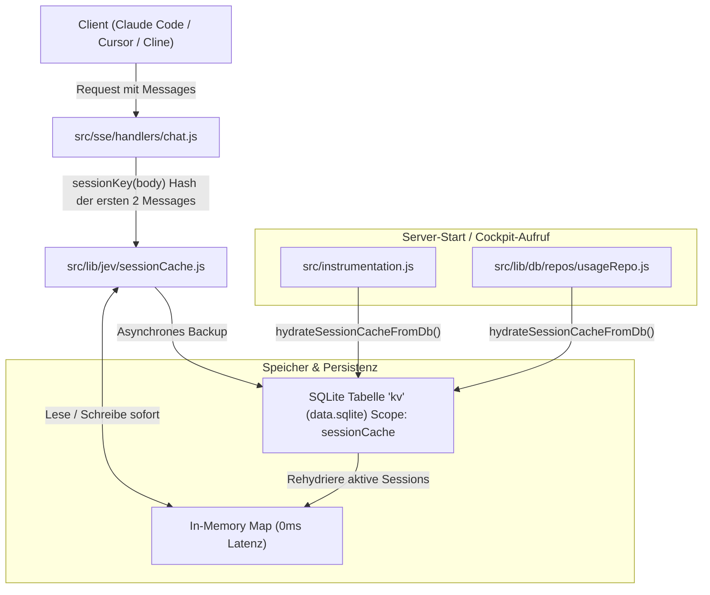

# Cockpit Active Sessions, Kontext-Visualisierung & Session-Persistenz

Diese Dokumentation beschreibt die Architektur, Datenflüsse und Komponenten für:
1. Die **visuelle Überwachung aktiver Sessions und Pings** im Cockpit.
2. Die Anzeige von **Kontextgröße** und **Gesamt-Kontext**.
3. Die **Persistenz von Sessions und Caches** über Neustarts von PiRouter hinweg.
4. Die **Trennung von System-Combos (z. B. Haiku)** von Jevs intelligenter Modellauswahl.

---

## 1. Visuelle Active Sessions & Ping Waveform im Cockpit

### Ziel
Eine visuelle Echtzeit-Übersicht aller laufenden KI-Gespräche (Sessions) und deren einzelner Anfragen (Pings/Turns), inklusive Token-Kontext und Cache-Status.

### Komponente: `ActiveSessionsVisualizer.js`
Pfad: [`src/app/(dashboard)/dashboard/cockpit/ActiveSessionsVisualizer.js`](file:///home/oguz/projects/Pirouter/src/app/(dashboard)/dashboard/cockpit/ActiveSessionsVisualizer.js)  
Eingebettet in: [`CockpitClient.js`](file:///home/oguz/projects/Pirouter/src/app/(dashboard)/dashboard/cockpit/CockpitClient.js)

### Funktionsumfang & UI-Elemente
- **Globaler Status & Schnellmetriken (Kopfzeile):**
  - Live-Beacon mit Pulsieren bei aktiven Verbindungen.
  - Aktive Sessions vs. Gesamtanzahl.
  - Globale KV-Cache-Hit-Rate.
  - **Aktiver Kontext** (Kontextgröße des jeweils neuesten Turns aller aktiven Sessions).
  - **Gesamt-Kontext** (kumulierte Prompt-Tokens über alle aufgezeichneten Sessions).
  - Gesamtzahl aller Pings.
- **Session-Karten:**
  - Status-Pille: *Aktiv* (letzte Aktivität < 5 Minuten) vs. *Inaktiv / Idle*.
  - Provider- & Modell-Badges mit Provider-Farben (Claude, Gemini, OpenAI, GLM, etc.).
  - 1-Klick-Kopieren der Session-ID (`#11a20246fb2fee03`).
  - Direkter Link zur vollständigen Session-Detailseite.
- **Zweistufige Kontext- & Token-Gauges:**
  1. **Aktuelle Kontextgröße vs. Max Modell-Limit:**  
     Zeigt die Kontextgröße der letzten Anfrage im Verhältnis zum Limit des Modells (z. B. `57.2K / 200K (28.6%)`) mit farbigem Auslastungsbalken (Grün < 50%, Gelb < 80%, Rot >= 80%).
  2. **Insgesamt Kontext vs. Gecachter Kontext:**  
     Zeigt die kumulierten Prompt-Tokens der Session und den gecachten Anteil inklusive KV-Cache Hit-Rate.
- **Interaktive Ping-Node-Leiste (Waveform):**
  - Jeder Ping (`#1`, `#2`, `#3` ...) ist als kompakter interaktiver Node dargestellt.
  - Direkte Beschriftung auf dem Node: **`Kontext: XX.Xk`**, Cache-Badge (**`⚡ XX.Xk Cache`** vs. `Live`) und Latenz in ms.
  - Klick öffnet ein Detail-Modal mit exakter Aufschlüsselung (`Kontextgröße (Prompt)`, `Gecachte Tokens`, `Latenz`, `Timestamp`, `Modell`, `Provider`).
- **Ansichten & Filter:**
  - Umschaltung zwischen **Karten-Ansicht** und **Ping-Stream (Timeline/Waterfall)**.
  - Umschaltung zwischen **Nur Aktive** und **Alle Sessions**.

---

## 2. Session-Persistenz über Neustarts hinweg

### Problemstellung
Vor der Persistierung wurden Sessions und Sticky-Pins ausschließlich im flüchtigen Prozessspeicher (`globalThis`) gehalten. Bei jedem Container-Neustart (z. B. nach Updates, Server-Reboots oder Deployments) wurden alle Sessions verworfen. Beim nächsten Request des Clients (Cursor, Claude Code, Cline etc.) wurde eine neue zufällige Session-ID generiert, wodurch Verlauf, Cache-Statistiken und Kontext-Tracking verloren gingen.

### Persistenz-Architektur

### Komponenten & Implementierung

1. **Stabile Session-Key-Erkennung (`sessionModels.js`):**
   - Funktion: `sessionKey(body)`
   - Erzeugt einen SHA-1-Hash aus den ersten zwei Nachrichten (`role + content`) des Chats.
   - Da die ersten beiden Nachrichten (System-Prompt + erste Benutzeranfrage) über alle Folgeturns identisch bleiben, erzeugt derselbe Chat vor und nach einem Router-Neustart **exakt denselben SessionKey**.

2. **Dauerhafte SQLite-Ablage (`sessionCache.js`):**
   - Speicherort: SQLite-Tabelle `kv` mit Scope `'sessionCache'`.
   - Bei jedem `touchSessionCache` oder `updateSessionCacheUsage` wird das Session-Objekt (ID, Requests, Turns, Token-Metriken, Provider, Modelle) asynchron per `makeKv("sessionCache").set(key, entry)` in SQLite persistiert.
   - Bei Ablauf (`TTL_MS = 2 * 60 * 60 * 1000`, 2 Stunden Inaktivität) oder Pruning (> 200 Sessions) wird der Eintrag auch aus SQLite gelöscht.
   - Prompt-Cache-Keep-Alive misst die maximale Ruhezeit seit dem letzten echten Request über `lastUserActive`: explizit aktivierte Sessions bis 45 Minuten, Top-N-Sessions bis 2 Stunden. Erfolgreiche Probe-Pings aktualisieren nur `lastActive` für die Cache-TTL, nicht `lastUserActive`; danach enden die Pings. Für ältere gespeicherte Einträge ohne `lastUserActive` dient `createdAt` als konservativer Startpunkt.

3. **Sticky-Modell-Persistenz (`sessionModels.js`):**
   - Speichert die gemerkte Modellzuweisung für den nächsten Turn im Scope `'jevSessionModels'`.
   - Stellt sicher, dass nach einem Neustart des Routers weiterhin das gleiche Modell gewählt wird (Sticky Cache Hit).

4. **Automatisches Rehydrieren beim Start:**
   - In [`src/instrumentation.js`](file:///home/oguz/projects/Pirouter/src/instrumentation.js) werden bei Server-Start `hydrateSessionCacheFromDb()` und `hydrateSessionModelsFromDb()` aufgerufen.
   - In [`src/lib/db/repos/usageRepo.js`](file:///home/oguz/projects/Pirouter/src/lib/db/repos/usageRepo.js) wird `hydrateSessionCacheFromDb()` vor jedem Cockpit-Snapshot ausgeführt, falls noch nicht geladen.

---

## 3. Trennung: System-COMBOS (Haiku) vs. Jev-Router

### Hintergrund
Modelle wie `Haiku`, `Sonnet` oder `Opus` werden von Clients oft als Modellname übergeben (z. B. `model: "Haiku"`). In PiRouter sind dies **System-COMBOS**, die über eine eigene, priorisierte Fallback-Kette (z. B. lokale Modelle, Gemini Flash, Z.ai GLM) rotieren.

### Vorgenommene Trennung
1. **Case-Insensitive Combo-Erkennung:**
   - In [`combosRepo.js`](file:///home/oguz/projects/Pirouter/src/lib/db/repos/combosRepo.js) nutzt `getComboByName` nun `WHERE LOWER(name) = LOWER(?)`.
   - In [`open-sse/services/combo.js`](file:///home/oguz/projects/Pirouter/open-sse/services/combo.js) prüft `getComboModelsFromData` case-insensitiv (`c.name?.toLowerCase() === modelStr?.toLowerCase()`).
   - Anfragen an `Haiku`, `haiku` oder `HAIKU` landen damit immer zuverlässig im Combo-Handler `handleComboChat` und berühren Jev nicht.

2. **Ausschluss von Haiku aus Jevs Kandidaten-Pool:**
   - In der SQLite-Datenbank (`combos` Tabelle, Combo `jev`) wurden alle konkreten Haiku-Einträge (`gh/claude-haiku-4.5`, `cc/claude-haiku-4-5-20251001`) entfernt.
   - In [`src/sse/handlers/chat.js`](file:///home/oguz/projects/Pirouter/src/sse/handlers/chat.js) schließt der Filter `!modelId.toLowerCase().includes("haiku")` Haiku-Modelle strikt aus Jevs Auswahl aus.
   - **Ergebnis:** Jev trifft intelligente Routing-Entscheidungen ausschließlich für seine vorgesehenen Frontier/Mid-Modelle (GLM, Sonnet, Opus, Qwen etc.). Haiku bleibt ein eigenständiges, leichtes System-Combo.

---

## 4. Relevante Dateien im Projekt

| Datei | Funktion |
|---|---|
| [`src/app/(dashboard)/dashboard/cockpit/ActiveSessionsVisualizer.js`](file:///home/oguz/projects/Pirouter/src/app/(dashboard)/dashboard/cockpit/ActiveSessionsVisualizer.js) | React-Komponente für die visuelle Darstellung von Sessions, Kontextgröße und Ping-Nodes |
| [`src/app/(dashboard)/dashboard/cockpit/CockpitClient.js`](file:///home/oguz/projects/Pirouter/src/app/(dashboard)/dashboard/cockpit/CockpitClient.js) | Cockpit-Hauptseite; integriert den Visualizer und KPI-Footer |
| [`src/lib/jev/sessionCache.js`](file:///home/oguz/projects/Pirouter/src/lib/jev/sessionCache.js) | Session-Registry mit Token-Tracking, SQLite-Persistierung und Hydration |
| [`src/lib/jev/sessionModels.js`](file:///home/oguz/projects/Pirouter/src/lib/jev/sessionModels.js) | Sticky-Modell-Speicher mit Hash-Key-Erzeugung und SQLite-Persistierung |
| [`src/instrumentation.js`](file:///home/oguz/projects/Pirouter/src/instrumentation.js) | Server-Start-Hook; führt Rehydrierung der Sessions beim Boot aus |
| [`src/lib/db/repos/usageRepo.js`](file:///home/oguz/projects/Pirouter/src/lib/db/repos/usageRepo.js) | Cockpit-Daten-Aggregator; liefert Session-Snapshots inkl. Turns und Hydration |
| [`src/sse/handlers/chat.js`](file:///home/oguz/projects/Pirouter/src/sse/handlers/chat.js) | Chat-Handler; trennt Jev-Routing von Combos und filtert Haiku aus Jev aus |
| [`src/lib/db/repos/combosRepo.js`](file:///home/oguz/projects/Pirouter/src/lib/db/repos/combosRepo.js) | Datenbank-Zugriff auf Combos mit Case-Insensitive-Lookup |
| [`open-sse/services/combo.js`](file:///home/oguz/projects/Pirouter/open-sse/services/combo.js) | Combo-Fallback-Logik und Modellrotation mit Case-Insensitive-Matching |
| [`src/shared/components/EditConnectionModal.js`](file:///home/oguz/projects/Pirouter/src/shared/components/EditConnectionModal.js) | Account-Bearbeitungsmodal mit grafischem Drosselungs-Slider und Presets |
| [`src/sse/services/auth.js`](file:///home/oguz/projects/Pirouter/src/sse/services/auth.js) | Weighted Selection für gedrosselte Accounts und Session-Stickiness |

---

## 5. Quota Reset Credits, Bestätigungs-Modal & Zeit-Balken

### Ziel & Hintergrund
Anbieter wie GLM (Zhipu/Z.ai), Claude und OpenAI/Codex bieten Kontingent-Resets an (z. B. 1 wöchentlicher Reset für Pro/Team-Pläne oder Reset-Credits). PiRouter visualisiert diese Reset-Möglichkeiten und bietet eine sichere 1-Klick-Ausführung.

### Funktionen:
1. **Reset-Credit-Zähler & Action Button:**
   - Zeigt verfügbare Resets an (z. B. `⚡ 1 Reset`).
   - Button `Quota jetzt zurücksetzen` triggert die Upstream-Reset-API.
2. **Sicherheits-Bestätigungs-Modal:**
   - Verhindert versehentliches Auslösen.
   - Zeigt Account-Name, Provider, verbleibende Credits und eine Warnung.
   - Erst nach Klick auf `Bestätigen & Reset ausführen` wird der Reset gesendet.
3. **Dualer Zeit-Balken (Progress Bar):**
   - Neben der Quota-Auslastung wird das aktuelle Zeitfenster (5h / 24h / 7d) als optischer Fortschrittsbalken visualisiert.
   - Zeigt exakt an, wie viel Prozent des Zeitfensters bereits abgelaufen sind und wann der automatische Upstream-Reset erfolgt.

---

## 6. Account-Drosselung (Traffic-Gewichtung) & Session-Sticky Routing

### Ziel
Ermöglicht es, in der WebUI grafisch per Slider einzustellen, dass ein bestimmter Account (z. B. Account 1) vorübergehend weniger genutzt wird als Account 2 (z. B. um Quota zu schonen), **ohne dabei die Caching-Logik (Prompt- und KV-Cache) zu beeinträchtigen**.

### Grafische Konfiguration in der WebUI
- Im Account-Bearbeitungs-Modal ([`EditConnectionModal.js`](file:///home/oguz/projects/Pirouter/src/shared/components/EditConnectionModal.js)) gibt es einen intuitiven Schieberegler von **0% bis 100%**:
  - **`0% (Normal)`**: Voller Traffic-Anteil (Gewichtung 100).
  - **`25%`, `50%`, `75%`, `90%`**: Stufenweise Drosselung für neue Sessions.
  - **`100% (Standby)`**: Dient als Notfall-Fallback und erhält nur dann Anfragen, wenn alle anderen Accounts belegt oder im Rate-Limit sind.
- Im Cockpit ([`CompactQuotaTracker.js`](file:///home/oguz/projects/Pirouter/src/app/(dashboard)/dashboard/cockpit/CompactQuotaTracker.js)) und auf der Connections-Seite ([`ConnectionsCard.js`](file:///home/oguz/projects/Pirouter/src/app/(dashboard)/dashboard/providers/components/ConnectionsCard.js)) wird ein auffälliges Badge `📉 X% gedrosselt` angezeigt.

### Wie das Caching zu 100% erhalten bleibt
1. **Weighted Routing ausschließlich für NEUE Unterhaltungen:**
   - Startet ein Client (z. B. Cursor oder Claude Code) einen neuen Chat, berechnet PiRouter die effektiven Gewichte aller aktiven Accounts:
     $$\text{Gewicht} = \max(1, 100 - \text{throttlePercent})$$
   - Ein Account mit 80% Drosselung erhält bei neuen Chats nur $20 / (20 + 100) \approx 16.7\%$ der neuen Sessions, während ein ungedrosselter Account $\approx 83.3\%$ erhält.
2. **Strikte Session-Stickiness für laufende Unterhaltungen:**
   - Aus den ersten Nachrichten des Requests wird ein stabiler deterministischer Hash (`sessionKey(body)`) erzeugt.
   - Sobald ein Request erfolgreich auf einem Account verarbeitet wurde, speichert PiRouter diesen Account über `setSessionConnection(sessionKey, connectionId)`.
   - Alle nachfolgenden Anfragen (Turns) desselben Chats werden über `preferredConnectionId` **ausnahmslos an denselben Account weitergeleitet**.
   - **Ergebnis:** Der Prompt-Cache des Upstream-Anbieters (Anthropic Prefix-Cache, OpenAI Prompt Cache, KV-Cache) bleibt vollständig intakt. Kein unnötiger Cache-Miss, keine zusätzlichen Kosten!
3. **Automatischer Fallback bei Fehlern:**
   - Sollte der gepinnte Account während einer Unterhaltung ein Rate-Limit (429) oder einen Fehler melden, schlägt die Fehlertoleranz an: PiRouter leitet die Anfrage auf den nächsten gesunden Account um und pinnen die Session ab diesem Zeitpunkt an den neuen Account.

