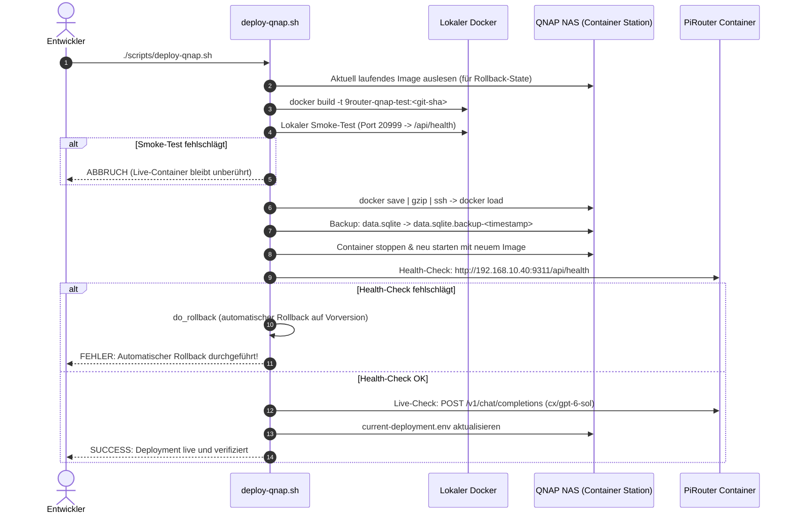

# PiRouter QNAP Deployment & Rollback Guide

Dokumentation für den produktiven Betrieb von PiRouter auf dem QNAP NAS (`192.168.10.40:9311`).

## 1. Übersicht & Zielsetzung

Da AI-Agenten (z. B. Pi) rund um die Uhr auf den PiRouter als Gateway angewiesen sind, darf ein Deployment niemals zu einem unbemerkten oder anhaltenden Ausfall führen.

Das Skript [`scripts/deploy-qnap.sh`](../scripts/deploy-qnap.sh) automatisiert den gesamten Lifecycle:
- **Lokaler Pre-Flight & Build**: Baut das Docker-Image lokal mit Git-Commit-Tagging.
- **Lokaler Smoke-Test**: Startet einen isolierten Testcontainer lokal und wartet auf `health: 200`. Bricht sofort ab, falls der Build defekt ist (Live-System bleibt unangetastet).
- **Automatisches Remote DB-Backup**: Sichert die SQLite-Datenbank (`data.sqlite`) auf dem NAS vor dem Umschalten.
- **Automatischer Rollback**: Schlägt die Health-Prüfung nach dem Start fehl, schaltet das Skript automatisch innerhalb von Sekunden auf das vorherige funktionierende Image zurück.
- **End-to-End Chat-Verifikation**: Führt nach erfolgreichem Health-Check einen Live-Ping via `cx/gpt-6-sol` aus.

---

## 2. Befehlsreferenz

Alle Befehle werden aus dem Repository-Root ausgeführt:

```bash
# Status und Health des laufenden QNAP-Containers abfragen
./scripts/deploy-qnap.sh --status

# Neues Release bauen, prüfen, sichern und deployen
./scripts/deploy-qnap.sh

# Sofortiges Rollback auf das vorherige Image
./scripts/deploy-qnap.sh --rollback
```

---

## 3. Architektur & Container-Spezifikation (QNAP)

| Parameter | Wert |
| :--- | :--- |
| **Host** | `qnap` (`192.168.10.40`) |
| **Container-Name** | `9router-qnap-test` |
| **Port-Mapping** | `9311:20128` (Bridge) |
| **Data Mount** | `/share/CE_CACHEDEV1_DATA/Container/9router-test/data-home:/app/data` |
| **Backup-Verzeichnis** | `/share/CE_CACHEDEV1_DATA/Container/9router-test/backups` |
| **State-Datei** | `/share/CE_CACHEDEV1_DATA/Container/9router-test/current-deployment.env` |
| **Restart-Policy** | `always` |
| **Docker-Binary (QNAP)** | `/share/CE_CACHEDEV1_DATA/.qpkg/container-station/bin/docker` |

---

## 4. Ablauf eines Deployments (`do_deploy`)



---

## 5. Manuelles Rollback & Notfall-Wiederherstellung

Falls ein Problem erst im laufenden Betrieb auffällt:
```bash
./scripts/deploy-qnap.sh --rollback
```

Das Skript liest die `current-deployment.env` auf der QNAP aus und startet unverzüglich das in `PREVIOUS_IMAGE` hinterlegte Image. Sollte die State-Datei nicht existieren, greift das Skript automatisch auf das bekannte Notfall-Image `9router-qnap-test:rescue-1348de3c` zurück.

### Manuelle Notfall-Befehle via SSH (falls das Skript nicht genutzt werden kann):
```bash
ssh qnap
D=/share/CE_CACHEDEV1_DATA/.qpkg/container-station/bin/docker

# 1. Container stoppen und entfernen
$D stop 9router-qnap-test && $D rm 9router-qnap-test

# 2. Auf stabiles Rescue-Image starten
$D run -d --name 9router-qnap-test --restart always \
  -p 9311:20128 \
  -v /share/CE_CACHEDEV1_DATA/Container/9router-test/data-home:/app/data \
  9router-qnap-test:1064a675
```
